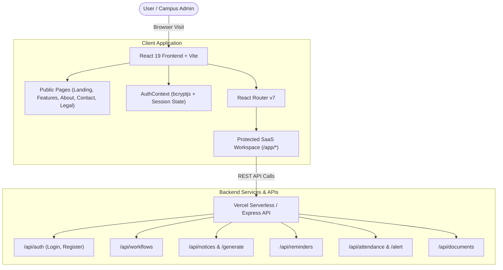

# 🎓 CampusFlow AI — Intelligent Campus Automation Platform

[](https://campusflow-ai-two.vercel.app/)
[](https://react.dev/)
[](https://vitejs.dev/)
[](https://nodejs.org/)
[](LICENSE)

> **"Stop Managing Tasks. Start Automating Workflows."**  
> CampusFlow AI is an end-to-end commercial SaaS application engineered to transform everyday instructions, administrative circulars, syllabi, and repetitive clerical routines into autonomous, intelligent academic workflows.

---

## 🌐 Live Production Links

* 🚀 **Web Application (Frontend + Auth + Dashboard):**  
  [https://campusflow-ai-two.vercel.app/](https://campusflow-ai-two.vercel.app/)
  
* ⚡ **Backend REST API:**  
  [https://campusflow-ai-two.vercel.app/api](https://campusflow-ai-two.vercel.app/api)

* 🩺 **Backend Health & Status:**  
  [https://campusflow-ai-two.vercel.app/api/health](https://campusflow-ai-two.vercel.app/api/health)

* 📦 **GitHub Repository:**  
  [https://github.com/Cerin456/Campusflow-AI.git](https://github.com/Cerin456/Campusflow-AI.git)

---

## 📑 Table of Contents

- [Core Value Proposition](#-core-value-proposition)
- [Key Features](#-key-features)
- [Platform Architecture](#-platform-architecture)
- [Tech Stack](#-tech-stack)
- [User Journey](#-user-journey)
- [REST API Endpoints](#-rest-api-endpoints)
- [Project Directory Structure](#-project-directory-structure)
- [Local Installation & Setup](#-local-installation--setup)
- [Deployment Instructions](#-deployment-instructions)
- [Contributing & License](#-contributing--license)

---

## 💡 Core Value Proposition

Academic institutions frequently lose hundreds of administrative hours every semester wrestling with fragmented communication tools, manual circular drafting, repetitive reminders, missed syllabus milestones, and tedious attendance follow-ups.

**CampusFlow AI replaces this friction with an autonomous execution engine:**
1. **Understands Natural Instructions:** Translates raw faculty prompts into standardized, formatted official memos.
2. **Autonomous Multi-Channel Triggers:** Coordinates reminders for exams, project deadlines, and fee submission cutoffs.
3. **Automated Compliance & Warnings:** Scans student attendance and triggers proactive notifications to students and guardians.
4. **Deterministic Auditability:** Every automated action is logged with timing metrics and execution receipts.

---

## ⚡ Key Features

### 1. 🌟 Premium SaaS Public Landing Page (`/`)
- **Sticky Glassmorphism Navbar**: Responsive navigation with smooth scrolling to sections (`#features`, `#how-it-works`, `#use-cases`), mobile hamburger drawer, and fast routing.
- **Hero Section**: Dark navy aesthetics (`#0B0F19`), glowing ambient orbs, grid pattern, floating workflow badges (*Notice Generated*, *Reminder Scheduled*, *Email Prepared*), and a live interactive dashboard preview.
- **Problem & Solution Matrix**: Visual comparison highlighting the pains of manual campus paperwork versus automated flow.
- **8 Core Capability Cards**:
  1. *AI Document Intelligence*
  2. *Smart Notice Generation*
  3. *Automated Email Notifications*
  4. *Intelligent Reminder Scheduling*
  5. *Attendance Automation*
  6. *Visual Workflow Builder*
  7. *Workflow Monitoring*
  8. *AI-Powered Task Extraction*
- **Connected 4-Step Timeline**: Visual guide demonstrating the Input $\rightarrow$ Understand $\rightarrow$ Automate $\rightarrow$ Deliver lifecycle.
- **Role-Tailored Solutions**: Dedicated tracks for **Educators**, **Students**, and **Institutional Administrators**.
- **Transparent Impact Metrics**: Benchmark counters with explicit disclaimers regarding simulated telemetry.

### 2. 🔐 Secure Authentication & Session Management
- **Registration (`/register`)**: Full name, institutional email, role selector (*Student*, *Educator*, *Administrator*), institution name, real-time password strength meter, visibility toggles, and terms compliance.
- **Enterprise-Grade Cryptography**: Real password hashing via `bcryptjs` with persistent session state management.
- **Login (`/login`)**: Secure credential verification with "Remember Me" session retention.
- **3-Step Password Recovery (`/forgot-password`)**: Request single-use recovery code $\rightarrow$ verify 6-digit code $\rightarrow$ set and hash new password.

### 3. 🚀 Multi-Step Guided Onboarding (`/onboarding`)
- Guides new signups through:
  1. Role confirmation
  2. Institution identity & organization tier
  3. Primary workflow focus selection
  4. Communication & digest preferences
- Concludes with a personalized celebration screen featuring 4 instant quickstart action cards.
- Includes a direct **Skip** option.

### 4. 📊 Protected SaaS Application Dashboard (`/app/*`)
- **Collapsible Sidebar Layout**: Clean navigation between modules, global search, and instant sign-out.
- **Overview Dashboard (`/app/dashboard`)**: Metric stats, weekly automation throughput bar chart, recent events, and upcoming milestones.
- **Workflow Automations (`/app/automations`)**: Filterable automation cards (*All*, *Active*, *Paused*) with pause/resume toggles and an automation builder modal.
- **Smart Notices (`/app/notices`)**: Generative memo creator generating university-formatted circulars with official reference numbers.
- **Intelligent Reminders (`/app/reminders`)**: Priority-coded schedule grid (*High*, *Medium*, *Low*) with modal to add new milestones.
- **Attendance Automation (`/app/attendance`)**: Roster monitoring student shortage thresholds below 75% with one-click automated parent warning letters.
- **Documents (`/app/documents`)**: Drag-and-drop intake zone with AI task extraction summaries.
- **Execution History (`/app/history`)**: Immutable audit trail with execution durations and status indicators.
- **Settings (`/app/settings`)**: Profile, institution affiliation, and alert channel preferences.

---

## 🏛️ Platform Architecture



---

## 🛠️ Tech Stack

### Frontend
- **Library / Framework:** [React 19](https://react.dev/)
- **Build Tool:** [Vite 8](https://vitejs.dev/)
- **Routing:** [React Router v7](https://reactrouter.com/)
- **Icons:** [Lucide React](https://lucide.dev/)
- **Typography:** Plus Jakarta Sans & JetBrains Mono (Google Fonts)
- **Security:** [bcryptjs](https://www.npmjs.com/package/bcryptjs)
- **Design System:** Custom CSS Design System (Dark Navy `#0B0F19`, Indigo `#4F46E5`, Violet `#7C3AED`, Cyan `#06B6D4`)

### Backend
- **Server Framework:** [Node.js](https://nodejs.org/) & [Express 5](https://expressjs.com/)
- **Middleware:** CORS, JSON Body Parser
- **Deployment Adapter:** Vercel Serverless API Functions (`api/index.js`)

### Hosting & Infrastructure
- **Cloud Provider:** [Vercel](https://vercel.com/)
- **Routing Configuration:** Rewrites for Single Page Application (SPA) + Serverless REST API in `vercel.json`

---

## 🔄 User Journey

```
Visitor 
  │
  ├──> Landing Page (/)
  │       │
  │       └──> Explore Features / Solutions
  │
  ├──> Register (/register)
  │       │
  │       └──> Choose Role (Educator, Student, Admin)
  │
  ├──> Onboarding (/onboarding)
  │       │
  │       └──> Institution & Preferences Setup
  │
  ├──> Protected Dashboard (/app/dashboard)
  │       │
  │       ├──> Create & Toggle Workflows (/app/automations)
  │       ├──> Generate Official Notices (/app/notices)
  │       ├──> Schedule Deadlines (/app/reminders)
  │       ├──> Auto-Dispatch Attendance Alerts (/app/attendance)
  │       └──> Upload & Parse Documents (/app/documents)
  │
  └──> Sign Out (Clears session, redirects to /)
```

---

## 📡 REST API Endpoints

| Method | Endpoint | Description | Sample Output |
| :--- | :--- | :--- | :--- |
| `GET` | `/api` | Root API directory and service discovery | `{"status": "online", "version": "2.4.0"}` |
| `GET` | `/api/health` | System health check and uptime | `{"status": "healthy", "uptime": 120.4}` |
| `POST` | `/api/auth/register` | Create user account with bcrypt hashing | `{"success": true, "user": {...}}` |
| `POST` | `/api/auth/login` | Authenticate user & issue session token | `{"success": true, "token": "cf_jwt_..."}` |
| `GET` | `/api/workflows` | Retrieve configured workflows | `{"success": true, "workflows": [...]}` |
| `POST` | `/api/workflows` | Build and deploy a new automation recipe | `{"success": true, "workflow": {...}}` |
| `GET` | `/api/notices` | Fetch published circular archive | `{"success": true, "notices": [...]}` |
| `POST` | `/api/notices/generate`| Generate AI memo from prompt/requirements | `{"success": true, "notice": {...}}` |
| `GET` | `/api/reminders` | Fetch upcoming milestone alerts | `{"success": true, "reminders": [...]}` |
| `POST` | `/api/reminders` | Schedule a new deadline reminder | `{"success": true, "reminder": {...}}` |
| `GET` | `/api/attendance` | Audit student attendance roster | `{"success": true, "records": [...]}` |
| `POST` | `/api/attendance/alert` | Trigger automated warning notices | `{"success": true, "message": "Dispatched..."}` |
| `GET` | `/api/documents` | Ingested PDF document archive | `{"success": true, "documents": [...]}` |

---

## 📂 Project Directory Structure

```
Campusflow-AI/
├── api/
│   └── index.js                      # Vercel serverless function entry
├── server/
│   └── server.js                     # Express REST API server
├── src/
│   ├── assets/                       # Branding graphics and SVGs
│   ├── components/
│   │   ├── common/
│   │   │   ├── LoadingScreen.jsx     # Branded loading spinner
│   │   │   └── ProtectedRoute.jsx    # Authentication & onboarding gatekeeper
│   │   ├── landing/                  # Modular landing page components
│   │   │   ├── CTA.jsx               # High-conversion gradient CTA banner
│   │   │   ├── Features.jsx          # 8 Platform capability cards
│   │   │   ├── Footer.jsx            # Multi-column footer & legal links
│   │   │   ├── Hero.jsx              # Hero section with live preview & floating badges
│   │   │   ├── HowItWorks.jsx        # 4-Step connected timeline
│   │   │   ├── Impact.jsx            # Measurable metrics & disclaimer
│   │   │   ├── Navbar.jsx            # Sticky glassmorphism nav with mobile drawer
│   │   │   ├── Problems.jsx          # Pain points vs CampusFlow solution
│   │   │   ├── ProductPreview.jsx    # Real-time console preview component
│   │   │   └── UseCases.jsx          # Solutions for Educators, Students & Admins
│   │   └── layout/
│   │       └── AppLayout.jsx         # Collapsible sidebar, header & auth wrapper
│   ├── context/
│   │   └── AuthContext.jsx           # bcryptjs authentication provider & storage
│   ├── pages/
│   │   ├── app/                      # Authenticated SaaS modules
│   │   │   ├── AttendancePage.jsx    # Attendance roster & parent notices
│   │   │   ├── AutomationsPage.jsx   # Workflow builder & pause/play controls
│   │   │   ├── DashboardPage.jsx     # Master analytics, charts & quick actions
│   │   │   ├── DocumentsPage.jsx     # Drag-and-drop document intake
│   │   │   ├── HistoryPage.jsx       # Immutable execution audit trail
│   │   │   ├── NoticesPage.jsx       # Smart notice generator & publisher
│   │   │   ├── RemindersPage.jsx     # Priority-coded milestone manager
│   │   │   └── SettingsPage.jsx      # Profile, role & notification preferences
│   │   └── public/                   # Publicly accessible routes
│   │       ├── AboutPage.jsx         # Mission, principles & vision
│   │       ├── ContactPage.jsx       # Interactive inquiry submission form
│   │       ├── FeaturesPage.jsx      # Dedicated deep-dive feature explorer
│   │       ├── ForgotPasswordPage.jsx# 3-step password recovery flow
│   │       ├── LandingPage.jsx       # Main public SaaS landing page
│   │       ├── LoginPage.jsx         # Secure user login
│   │       ├── NotFoundPage.jsx      # Custom 404 handler
│   │       ├── OnboardingPage.jsx    # Post-signup configuration wizard
│   │       ├── PrivacyPage.jsx       # Data privacy & student safety policy
│   │       ├── RegisterPage.jsx      # Multi-role account registration
│   │       └── TermsPage.jsx         # Institutional service agreement
│   ├── styles/
│   │   └── index.css                 # Master production stylesheet
│   ├── utils/
│   │   ├── animations.js             # IntersectionObserver scroll animations
│   │   ├── sampleData.js             # Datasets, metrics & chart entries
│   │   └── validators.js             # Form & password complexity validators
│   ├── App.jsx                       # Master React Router v7 configuration
│   └── main.jsx                      # React 19 application root
├── index.html                        # Application HTML shell
├── package.json                      # Dependencies and build scripts
├── vercel.json                       # Deployment rewrites & API routing
└── vite.config.js                    # Vite configuration
```

---

## 💻 Local Installation & Setup

### Prerequisites
- [Node.js](https://nodejs.org/) (v18.0.0 or higher recommended)
- [npm](https://www.npmjs.com/) (v9.0.0 or higher)

### 1. Clone the Repository
```bash
git clone https://github.com/Cerin456/Campusflow-AI.git
cd Campusflow-AI
```

### 2. Install Dependencies
```bash
npm install
```

### 3. Start Development Server
```bash
npm run dev
```
Open [http://localhost:5173](http://localhost:5173) in your browser.

### 4. Run Standalone Backend API (Optional)
To run the Express REST API independently on port `5000`:
```bash
npm run server
```

### 5. Build for Production
```bash
npm run build
npm run preview
```

---

## 🚀 Deployment Instructions

### Deploy to Vercel (CLI)

The repository includes a production-ready `vercel.json` configured for Single-Page Application (SPA) rewrites and Serverless REST API endpoints.

1. Install Vercel CLI globally:
   ```bash
   npm install -g vercel
   ```

2. Authenticate and deploy:
   ```bash
   vercel --prod
   ```

3. Vercel will automatically build the Vite frontend (`dist/`) and deploy the serverless functions in `api/index.js`.

---

## 🤝 Contributing

Contributions to CampusFlow AI are welcome! Please follow these steps:
1. Fork the repository.
2. Create your feature branch (`git checkout -b feature/AmazingFeature`).
3. Commit your changes (`git commit -m 'Add some AmazingFeature'`).
4. Push to the branch (`git push origin feature/AmazingFeature`).
5. Open a Pull Request.

---

## 📄 License

Distributed under the MIT License. See `LICENSE` for more information.

---

## 📬 Contact & Support

* **Project Repository:** [https://github.com/Cerin456/Campusflow-AI.git](https://github.com/Cerin456/Campusflow-AI.git)
* **Direct Inquiries:** [support@campusflow.ai](mailto:support@campusflow.ai)
* **Platform Live URL:** [https://campusflow-ai-two.vercel.app/](https://campusflow-ai-two.vercel.app/)
